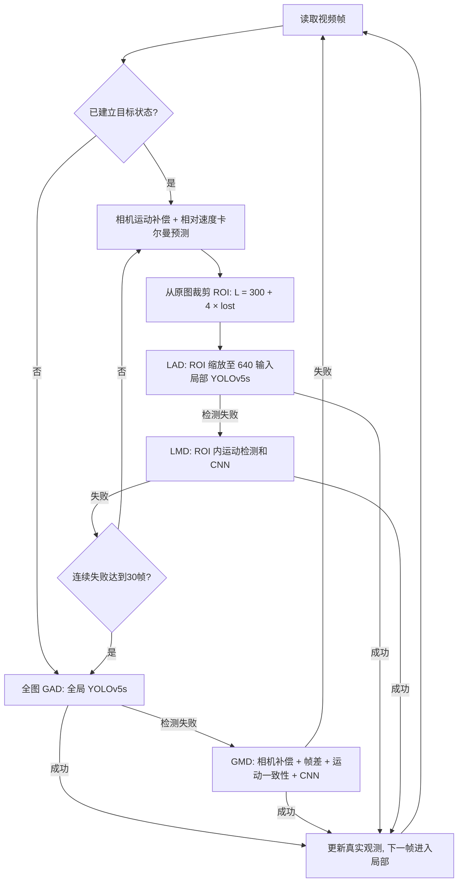

# GLAD 微小无人机检测复现

独立复现 **Global-Local MAV Detection under Challenging Conditions based on Appearance and Motion** 的推理流程。使用作者公开的全局 YOLOv5s、局部 YOLOv5s 和运动候选分类器权重，支持视频读取、全局/局部切换、相机运动补偿、运动候选识别、相对速度预测、自适应 ROI、检测视频及逐帧日志。

**复现范围：公开权重推理 + 未公开组件的论文逻辑重建。没有重新训练论文的全部模型，也没有宣称达到论文 AP 或板端 FPS。** 作者公开仓库仅提供基础代码，未公布完整卡尔曼预测和自适应搜索实现；其原演示依赖 Linux、NVIDIA TensorRT 与 CUDA。本项目将推理适配为 PyTorch，并将工程选择列在 [复现差异](docs/reproduction_scope.md)。

- 论文：https://arxiv.org/abs/2312.11008
- 官方代码：https://github.com/WindyLab/Global-Local-MAV-Detection
- 本项目独立于 YOLOMG，不加载 YOLOMG 权重，不修改其代码或环境。

## 1. 运行方法

**Windows 11 + RTX 4060 迁移：** 参见 [GPU 迁移操作说明](docs/windows_rtx4060_migration.md)。新电脑使用独立 `.venv-cuda`、CUDA 12.6 版 PyTorch 和 `--device cuda:0`；本节后面的 CPU 安装命令用于 CPU 基线。

### 当前电脑

本目录已建立 `.venv`，作者权重位于 `weights/`，固定版本的 YOLOv5 位于 `external/yolov5/`。当前机器使用 CPU；AMD 集成显卡不会通过 `--device cuda:0` 自动获得加速。

在 PowerShell 中执行：

```powershell
Set-Location 'D:\Users\Desktop\bxk\small\glad_reproduction'
.\.venv\Scripts\python.exe -m glad `
  --source 'D:\Users\Desktop\bxk\视频\72ebd203198e372d6b64af2d4fb9531e.mp4' `
  --output runs\my_video
```

运行 phantom64：

```powershell
.\.venv\Scripts\python.exe -m glad `
  --source 'D:\Users\Desktop\bxk\small\yolomg_motion\datasets\ard100_recovered\ARD100\test_videos\phantom64.mp4' `
  --output runs\phantom64
```

`--output` 必须是新目录或空目录，避免覆盖已有实验。添加 `--display` 可打开实时预览窗口；按 `q` 停止。只跑前 120 帧可添加 `--max-frames 120`。完整选项：`python -m glad --help`。

### 新电脑安装

推荐 Python 3.9；以下版本组合在当前 Windows 环境验证。Linux 使用 `.venv/bin/python`。

```powershell
python -m venv .venv
.\.venv\Scripts\python.exe -m pip install --upgrade pip
.\.venv\Scripts\python.exe -m pip install torch==2.8.0 torchvision==0.23.0 --index-url https://download.pytorch.org/whl/cpu
.\.venv\Scripts\python.exe -m pip install -r requirements.txt
.\.venv\Scripts\python.exe scripts\bootstrap.py
.\.venv\Scripts\python.exe -m pytest -q
.\.venv\Scripts\python.exe -m glad --source 'D:\videos\phantom64.mp4' --output runs\phantom64
```

有 NVIDIA GPU 时安装相应的 PyTorch CUDA 构建，再使用 `--device cuda:0`。本次未验证 CUDA/TensorRT、ONNX 或板端部署，不把 CPU 实测外推为板端性能。

`bootstrap.py` 下载固定提交的作者权重和 YOLOv5 v6.0，验证 SHA-256。权重及上游源码不提交到本仓库。来源与校验值在 [source_manifest.json](scripts/source_manifest.json)。

## 2. 实现流程



1. **GAD/LAD**：两个不同的作者 YOLOv5s 权重。全局阈值 `0.5`、局部阈值 `0.1`；BGR 转 RGB、保持比例填充到 `640×640`。ROI 从原始分辨率图像裁剪后才缩放，确实进入局部网络。
2. **GMD/LMD**：外观未检出时才调用。利用稀疏光流和 RANSAC 补偿相机运动，帧差分割候选，再进行运动统计与作者 CNN 分类。
3. **预测与开窗**：状态为 `[vx, vy, ax, ay]`，预测相对运动；检测缺失时仅预测、不使用预测框作为新观测。ROI 默认 `300×300`，每次缺失增大 4 像素，边界处平移裁剪框以保留窗口尺寸。
4. **切换和坐标**：检测结果始终还原到全图坐标，连续局部失败 30 帧后回到全图搜索。预测位置不计为检测成功。

论文的 `320×320` 是局部训练样本裁剪尺寸；论文推理基础窗口为 `300×300`，公开演示固定窗口为 `320×320`。它们与网络输入 `640×640` 是不同概念。

## 3. 输出和实验

每次运行生成：

| 文件 | 内容 |
| --- | --- |
| `output.mp4` | 标注视频，优先 H.264；黄色检测框、蓝色搜索窗、右上角 ROI 细节，不画历史轨迹 |
| `frames.jsonl` | 逐帧框、置信度、检测分支、ROI、预测位置、丢失计数、耗时、运动拒绝原因 |
| `summary.json` | 参数、环境、分支统计、检测输出覆盖率、算法 FPS、含读取绘制编码的 FPS |
| `preview.jpg` | 第 10 帧之后首个有检测结果的预览图；没有满足条件的检测时不生成 |
| `output.ffmpeg.log` | 编码器日志 |

**检测输出覆盖率 ≠ 正确率、召回率或 AP。** 没有逐帧真值就只能说明多少帧输出了框，不能证明框住了真实无人机。各分支置信度也不保证相互校准。

默认实验参数：`imgsz=640, roi_size=300, roi_growth=4, max_lost=30, threads=4`。算法 FPS 包括搜索、预测、检测与状态更新，排除模型加载和预热；端到端 FPS 额外包含解码、日志、绘制、编码和收尾。视频播放帧率保持源视频帧率，不能拿播放 FPS 当推理 FPS。

消融实验示例（每次使用不同输出目录）：

```powershell
# 全局外观基线
.\.venv\Scripts\python.exe -m glad --source 'D:\videos\test.mp4' --global-only --no-motion --output runs\gad
# 全局/局部外观，关闭运动兜底
.\.venv\Scripts\python.exe -m glad --source 'D:\videos\test.mp4' --no-motion --output runs\appearance
# 固定局部窗口，关闭预测与窗口增长
.\.venv\Scripts\python.exe -m glad --source 'D:\videos\test.mp4' --fixed-roi --output runs\fixed
# 完整重建流程
.\.venv\Scripts\python.exe -m glad --source 'D:\videos\test.mp4' --output runs\adaptive
```

当前真实运行记录见 [本机验证](docs/local_validation.md)。完整训练及论文指标复现要求见 [复现范围](docs/reproduction_scope.md)。

## 4. 项目文件

| 路径 | 作用 |
| --- | --- |
| `glad/appearance.py` | YOLO 预处理/推理/NMS/坐标还原；候选分类器 |
| `glad/motion.py` | 相机补偿、帧差候选、运动一致性、候选分类 |
| `glad/predictor.py` | 相对速度卡尔曼预测与 ROI 几何 |
| `glad/pipeline.py` | 全局/局部状态机、候选关联与丢失恢复 |
| `glad/__main__.py` | 视频运行、日志、计时和 H.264 输出 |
| `glad/visualize.py` | 检测框和 ROI 放大预览 |
| `tests/` | 几何、运动、预测、状态切换、权重接口测试 |
| `scripts/bootstrap.py` | 固定版本源码/权重获取与校验 |
| `docs/reproduction_scope.md` | 与论文、作者演示的对应关系和差异 |
| `THIRD_PARTY.md` | 上游来源和许可边界 |
